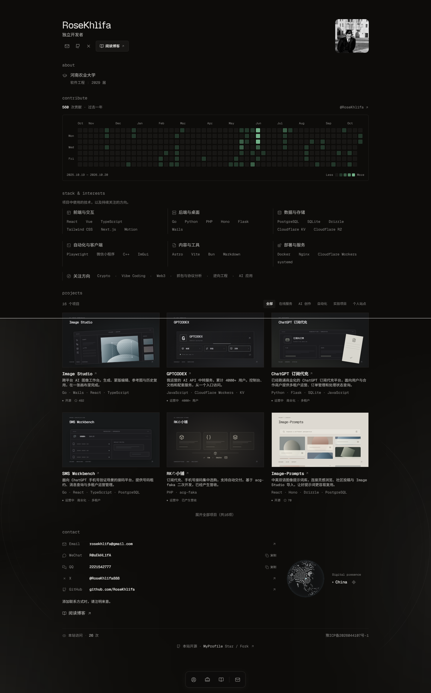

# MyProfile

RoseKhlifa 的个人主页，基于 [BartoszJarocki/cv — Minimalist CV](https://github.com/BartoszJarocki/cv) 二次开发。保留简历式信息结构与紧凑排版，加入项目展示、GitHub 动态和细腻交互。

源码：[RoseKhlifa/MyProfile](https://github.com/RoseKhlifa/MyProfile)。这是当前作者的个人站点源码，仓库中的头像、联系方式和项目文案均为个人内容；复用时请替换为自己的资料。



## 功能

- About、GitHub Contribute、Stack & Interests、项目目录与联系方式。
- 项目分类、展开／收起、独立动态封面、详情弹窗，以及公开仓库的 Star 数。
- GitHub 贡献热力图、单日详情与贪吃蛇动画，前台按小时检查更新。
- 文字入场、磁吸反馈、Dock、低对比动态背景和可交互地球；保留键盘操作与打印布局。
- 真实访问计数：SQLite 持久化，同一访问事件的重复请求在 24 小时内只计一次。
- Next.js 元数据、Open Graph、结构化数据、robots 与 sitemap。

技术基础为 Next.js 16、React 19、TypeScript、Tailwind CSS、Motion 和 Lucide，字体使用 Geist 与本地中文字体。

## 本地运行

推荐 **Node.js 24 LTS**，最低 **22.18**，以及 **pnpm 11.24.0**；访问计数使用 Node 内置的 `node:sqlite`。

尚未安装 pnpm 时，可使用 `npm install -g pnpm@11.24.0` 安装对应版本。

```sh
git clone git@github.com:RoseKhlifa/MyProfile.git
cd MyProfile
pnpm install --frozen-lockfile
pnpm dev --hostname 127.0.0.1 --port 4324
```

打开 <http://127.0.0.1:4324>。没有配置 SSH 密钥时，也可使用仓库的 HTTPS 克隆地址。

生产构建与本地预览：

```sh
pnpm build
pnpm start --hostname 127.0.0.1 --port 4324
```

运行方式为 **常驻 Node.js 服务**：贡献刷新接口与 SQLite 访问计数需要服务器运行时。项目保留这些功能时不使用纯静态导出。服务器配置见 [部署说明](docs/DEPLOYMENT.md)。

## 个性化

| 文件 | 内容 |
| --- | --- |
| `src/data/resume-data.ts` | 姓名、角色、教育信息、联系方式、博客地址、站点 URL 与头像导入。 |
| `src/data/projects.ts` | 项目介绍、分类、状态、访问入口、公开源码地址及封面类型。 |
| `src/data/stack.ts` | 技术分组、官方文档链接与兴趣方向。 |
| `src/lib/github-contributions.ts` | GitHub 用户名；更换用户时同步更新对应的贡献快照。 |
| `src/data/github-contributions.snapshot.json`、`src/data/github-stars.snapshot.json` | 网络请求失败时使用的真实数据快照，复用站点时换成自己的数据。 |
| `src/app/globals.css`、`tailwind.config.js` | 主题变量、字体映射与基础样式。 |

替换 `src/data/user-avatar.jpg` 与 `public/avatar.jpg`，并确认头像导入和公开图片路径一致。`siteUrl` 应使用自己的正式域名，供 canonical、分享图片和结构化数据使用。

Fork 后请同步调整 `src/data/projects.ts` 中的 `PROFILE_REPOSITORY`，它用于页脚等位置的源码链接；如果保留旧版微缩主页／博客预览，也请检查 `src/components/motion/project-preview.tsx` 中的作者显示。

GitHub 贡献与 Star 数读取公开接口，**无需 token**：贡献数据每小时再验证，Star 数每日再验证；接口失败时保留仓库中的快照。私有项目不需要配置公开源码链接。公开接口存在限额，页面已有回退数据可继续展示。

## 访问计数与数据

`GET /api/visits` 返回当前总数；`POST /api/visits` 提交 UUID v4 访问事件并返回总数。计数从真实的 0 开始，不写入演示访问量；保存总数、随机事件 ID 和过期时间，不保存 IP 或用户身份。

默认数据库为进程工作目录下的 `.data/visits.sqlite`。运行账号需要对该目录有写权限；可通过环境变量 `VISIT_COUNTER_DB` 指定另一个**绝对路径**。数据库目录应独立于每次发布的代码并持久保存，备份方式见部署说明。

## 检查

```sh
pnpm check
pnpm build
pnpm verify
node scripts/check-contributions.mjs --fixture-only
node scripts/check-contribution-refresh.mjs
node scripts/check-visit-counter.mjs
```

`pnpm check` 检查格式和 lint，`pnpm verify` 检查构建后的页面。访问计数测试使用临时数据库，覆盖持久化、重复请求和多进程并发，不改写站点数据库。

## 致谢与许可

项目基于 [Minimalist CV](https://github.com/BartoszJarocki/cv)，保留 [MIT LICENSE](LICENSE) 中 `Copyright (c) 2023 Bartosz Jarocki` 的版权与许可声明。再次分发代码时保留该声明。

个人头像、联系方式和项目文案请在复用部署前替换；字体按各自附带的许可证使用，本地中文字体许可见 `public/fonts/OFL-RKSans.txt`。
